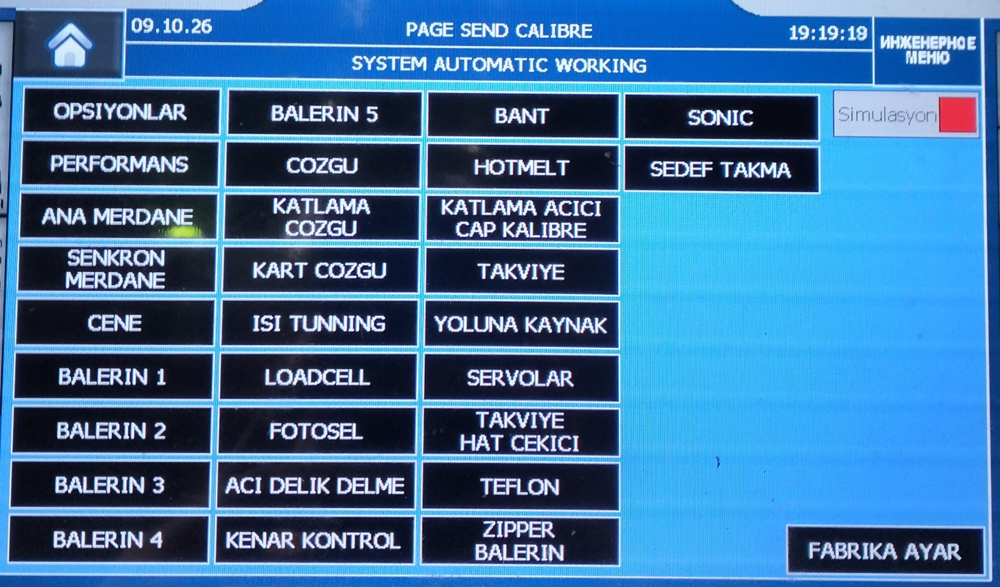

# Как сделать понятное фото для инструкции

Хорошая иллюстрация показывает именно ту деталь, о которой идёт речь. Этот тестовый мануал демонстрирует оформление текста и фотографий в SCADA.

## 1. Покажи экран целиком

На первой фотографии хорошо видны заголовок и расположение пунктов инженерного меню. Снимок можно использовать, чтобы объяснить, **где искать нужную страницу**.

Нажми на фотографию — она откроется крупным планом. Кнопки **+** и **−** меняют масштаб, **100%** возвращает размер по окну.

> Это фотография из ранее собранных материалов. Часы, дата и состояние на ней относятся к моменту съёмки.

## 2. Добавь короткое описание

1. Дай фотографии понятную подпись.
2. Укажи, на какой элемент нужно посмотреть.
3. Раздели длинную инструкцию на короткие шаги.

### Быстрая проверка

- [x] Заголовок экрана попал в кадр.
- [x] Надписи читаются.
- [ ] К каждой новой фотографии добавлена подпись.

Флажки в мануале служат примером оформления списка. Они не сохраняют отметки оператора.

## 3. Выбери подходящий кадр

| Что объясняем | Какой кадр удобнее |
| --- | --- |
| Где находится меню | Весь экран |
| Как выглядит отдельная кнопка | Крупный план кнопки |
| Как найти узел станка | Общий вид и отдельный крупный план |

**Одна фотография — одна мысль.** Если нужно объяснить несколько деталей, лучше добавить несколько кадров и короткие подписи.

---

Следующий пример: [как добавить свой мануал](../02-add-manual/index.md).
