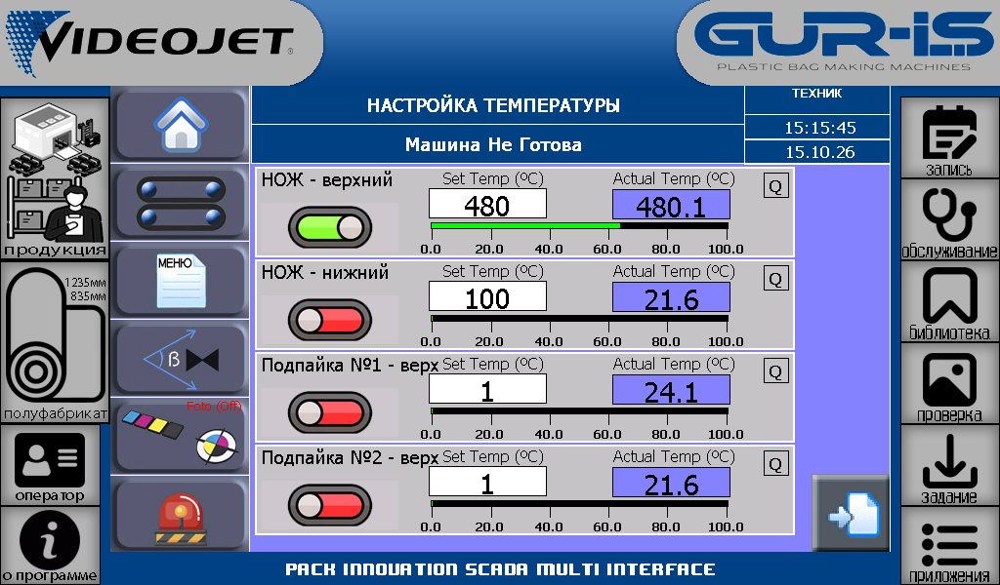

# Как добавить свой мануал

Каждая инструкция — отдельная папка в каталоге **manuals** рядом с EXE. Для обычного гайда достаточно файла `index.md` и папки с фотографиями.

## Шаг 1. Создай папку

Например:

```text
manuals/
  03-мой-гайд/
    index.md
    images/
      фото-1.jpg
      фото-2.png
```

Названия папок и фотографий могут содержать русские буквы и пробелы. Расширение текста — `.md`, кодировка — **UTF-8**.

## Шаг 2. Напиши текст

Markdown можно редактировать в обычном текстовом редакторе. В редакторе с предпросмотром сразу видны заголовки и фотографии.

Скопируй этот пример в `index.md`:

```markdown
# Название моей инструкции

Коротко объясни, чему посвящён гайд.

## Первый шаг

1. Опиши действие.
2. Добавь пояснение.


> Здесь можно оставить важную заметку.
```

Название в списке берётся из первого заголовка `#`. Краткое описание — из первого обычного абзаца.

## Шаг 3. Добавь фотографии

Положи фотографии в папку `images`. В Markdown укажи путь относительно `index.md`: например, `images/фото-1.jpg`.



Эта иллюстрация добавлена как пример фотографии внутри гайда. Показания на ней исторические.

Поддерживаются **JPG, JPEG, PNG и WebP**. Фото должно лежать в папке этого гайда или её подпапках. Каждую иллюстрацию можно открыть крупным планом.

## Шаг 4. Сохрани файл

Новая папка появится на странице **Мануалы** автоматически, обычно в течение 3 секунд. Для немедленной проверки нажми **Обновить**.

Если открыт уже существующий гайд, его текст не перескакивает во время чтения. После сохранения изменений появится кнопка **«Гайд изменён · обновить»**.

## Разделы и порядок

Для собственных названия, описания, раздела и порядка можно добавить в начало файла необязательный блок:

```yaml
---
title: Замена фотографии в гайде
summary: Короткое описание инструкции.
category: Мои инструкции
order: 30
---
```

Чем меньше `order`, тем выше гайд в списке. При одинаковом порядке используются названия папок. Метаданные пишутся в одну строку на поле.

## Если гайд не появился

- Убедись, что файл называется именно `index.md`, а не `index.md.txt`.
- Проверь кодировку UTF-8.
- Сохрани текстовый файл размером до 64 КБ; фотографии хранятся отдельно, каждая до 16 МБ.
- Убедись, что имя папки не начинается с точки или подчёркивания: такие папки скрыты из списка.
- Нажми **Обновить** на странице Мануалы.

SCADA показывает до 128 гайдов. Поддерживаются заголовки, списки, жирный текст, курсив, цитаты, таблицы, блоки кода, фотографии и ссылки на другие локальные гайды. Встроенный HTML показывается текстом; внешние картинки не загружаются.

Вернуться к [примеру оформления с фотографией](../01-photo-guide/index.md).
